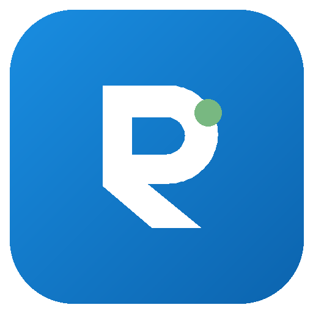

  

<h1 align="center">rdesk — downloads</h1>

Acesso remoto simples para <b>Windows</b> (como o AnyDesk). 
Baixe, abra e conecte por um <b>ID</b>; a outra máquina só precisa <b>aceitar</b>.

> O **código-fonte** fica num repositório privado. Aqui ficam só os **downloads**.

## Baixar

Vá em **[Releases](../../releases/latest)** e escolha:

| Arquivo | O que é |
|---|---|
| **rdesk-setup.exe** | Instalador (recomendado) — atalhos, firewall e opção de PATH. |
| **rdesk-windows-x64.zip** | Portátil — descompacte e rode `rdesk-gui.exe`, sem instalar. |

Windows 10/11 (64 bits). Na 1ª execução o SmartScreen pode avisar "editor
desconhecido" (app ainda não assinado): **Mais informações → Executar assim mesmo**.

## Como usar

1. **Na máquina a ser acessada:** abra o rdesk — já fica acessível **por
   confirmação**. Passe o **ID** (número grande). (Opcional: defina uma **senha**
   para acesso não supervisionado.)
2. **Na máquina que acessa:** digite o **ID** → **Conectar**. A outra máquina
   clica **Aceitar**. A tela aparece ao vivo, com mouse e teclado.

Pela internet funciona sem configurar nada (relay público embutido). O app
avisa e **se atualiza sozinho** quando sai uma versão nova.

## Recursos

- Tela ao vivo (H.264), mouse e teclado · acesso por **confirmação** ou **senha**
- **Sessões recentes** e favoritos · **busca na rede local**
- **Seleção de monitor** (host multi-monitor) · **prioridade do dono** no mouse
- **Indicador + janela** de "sendo acessado" · transferência de arquivos
- **Auto-update** no próprio app

## Segurança

Conexões criptografadas ponta a ponta. **Senha** = SPAKE2 (à prova de MITM) +
rate-limit. **Confirmação** = Noise XX com TOFU (a identidade do host é fixada
no 1º acesso). O relay não lê a sessão. Cada release traz `checksums-sha256.txt`.

Use apenas em máquinas suas ou com autorização explícita do dono.
